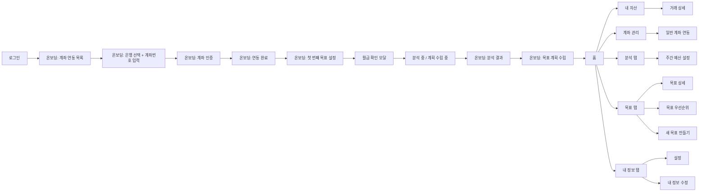

# 앱 화면 플로우 정리

배포 서버 `https://j14d101.p.ssafy.io/`를 CDP로 직접 탐색하며 확인한 화면만 정리했다.

- 기준: 2026-03-16, 로그인 후 실제 사용자 흐름 우선
- 원칙: 코드만 보고 추정한 화면은 본문에 넣지 않음
- 주의: Flutter 내부 내비게이션 때문에 일부 풀스크린 화면은 `location.href`가 이전 라우트로 유지됐다. 이 문서의 `Route`는 CDP에서 실제로 관측된 URL 기준이다.

## 앱 전체 흐름 요약

- 로그인 후 첫 진입은 `계좌 연동` 온보딩이었다.
- 계좌 연동 완료 후 `첫 번째 목표 설정`으로 이동했다.
- 목표 저장 후 `월급 확인` 모달과 `분석 중` 로딩을 거쳐 `분석 결과` 화면으로 이동했다.
- `분석 결과` 다음 단계에서 `목표 계획 수립` 화면이 열리고, 완료 후 메인 앱 `홈` 탭에 진입했다.
- 메인 앱에서는 `홈`, `분석`, `목표`, `내 정보` 4개 탭과 각 탭의 상세 화면을 확인했다.

## 흐름도

## 페이지 인덱스

| 페이지명 | Route | 진입 경로 | 화면에서 보이는 핵심 정보 | 사용자 액션 | 다음 이동 |
| --- | --- | --- | --- | --- | --- |
| 로그인 | `/#/login` | 앱 첫 진입 | `모아`, `카카오로 시작하기`, `구글로 시작하기` | 소셜 로그인 선택 | 카카오 로그인 완료 후 온보딩 진입 |
| 온보딩 계좌 연동 목록 | `/#/onboarding/account` | 로그인 직후 | 연결된 계좌 목록, `건너뛰기`, `새로운 계좌 연결하기`, `계좌 연동 완료` | 계좌 추가 또는 완료 | 은행 선택 단계 또는 목표 설정 |
| 온보딩 계좌 연동 입력 | `/#/onboarding/account` | `새로운 계좌 연결하기` | `은행 선택`, 은행 버튼 목록, `계좌번호`, `다음` | 은행 선택, 계좌번호 입력 | 계좌 인증 |
| 온보딩 계좌 인증 | `/#/onboarding/account` | 계좌 입력 후 `다음` | 4자리 인증 입력칸, 타이머, `인증번호 재전송`, `인증하기` | 인증번호 입력 | 연동 완료 |
| 온보딩 연동 완료 | `/#/onboarding/account` | 인증 완료 | `연동완료`, 은행명, 계좌번호, `다음` | 완료 확인 | 계좌 연동 목록 복귀 후 `계좌 연동 완료` |
| 온보딩 첫 번째 목표 설정 | `/#/onboarding/goal` | 계좌 연동 완료 | 목표 이름, 설명, 금액, 시작일, 종료일, `다음` | 목표 입력 | 월급 확인 모달 |
| 월급 확인 모달 | `/#/onboarding/loading` | 목표 저장 직후 | `월급을 확인해주세요`, `월 평균 수입`, `확인` | 수입 확인/수정 | 분석 로딩 |
| 분석 중 / 계획 수립 중 | `/#/onboarding/loading` | 월급 확인 후 | `분석 중`, `계획을 수립 중이에요` | 자동 진행 | 분석 결과 |
| 온보딩 분석 결과 | `/#/onboarding/analysis` | 로딩 완료 후 | 평균 수입/지출, 남은 금액, 고정비/변동비 비율, 카테고리별 지출, `다음` | 결과 확인 | 목표 계획 수립 |
| 온보딩 목표 계획 수립 | `/#/onboarding/analysis` | 분석 결과 `다음` | 주간 미션, 여유 자금, 주간 예산 요약, 저축비/고정비/변동비, `다음` | 계획 확인 | 홈 탭 |
| 홈 | `/#/home` | 온보딩 완료 | 자유소비 잔여 금액, 오늘 사용 가능 금액, `거래내역`, `계좌관리`, `저축 · 자산`, `목표` | 빠른 메뉴 선택 | 각 상세 화면 |
| 내 자산 | `/#/home` | 홈 `거래내역` | 총 자산, 날짜별 거래 목록, `소비패턴 알아보기` | 거래 선택 | 거래 상세 |
| 거래 상세 | `/#/home` | 내 자산 거래 항목 선택 | 거래명, 거래 시간, 거래 구분, 거래 금액, 거래 후 잔액 | 상세 확인 | 내 자산 복귀 |
| 계좌 관리 | `/#/home` | 홈 `계좌관리` | `계좌 관리`, `새로운 계좌 연결하기` | 계좌 추가 | 일반 계좌 연동 |
| 일반 계좌 연동 | `/#/home` | 계좌 관리 `새로운 계좌 연결하기` | 연결 계좌 목록, `새로운 계좌 연결하기`, `완료` | 계좌 추가 또는 완료 | 계좌 관리 복귀 |
| 분석 탭 | `/#/spending` | 하단 탭 `분석` | 주간/월간 전환, 기간, 총 지출, 그래프, 카테고리별 지출, `예산 설정하기 >` | 예산 설정 진입 | 주간 예산 설정 |
| 주간 예산 설정 | `/#/spending` | 분석 탭 `예산 설정하기 >` | 총 예산, 저축비, 고정비, 카테고리별 변동비, 여유 자금, `저장하기` | 예산 조정/저장 | 분석 재진입 예상 |
| 목표 탭 | `/#/goal` | 하단 탭 `목표` | `진행중`, `달성한`, 목표 카드 목록 | 목표 선택, 정렬, 생성 | 상세/우선순위/생성 |
| 목표 상세 | `/#/goal` | 목표 카드 선택 | 우선순위, D-day, 목표 금액, 남은 금액, 목표 설명, 달성 현황, 저축 이력 | 상세 확인 | 목표 탭 복귀 |
| 목표 우선순위 | `/#/goal` | 목표 탭 정렬 버튼 | `목표 우선순위`, `드래그하여 우선순위를 변경하세요`, `저장` | 순서 조정 | 목표 탭 복귀 |
| 새 목표 만들기 | `/#/goal` | 목표 탭 플로팅 버튼 | 목표 이름, 설명, 금액, 시작일, 종료일, `생성하기` | 목표 생성 | 목표 탭 복귀 |
| 내 정보 탭 | `/#/menu` | 하단 탭 `내 정보` | 진행중 목표 수, 달성한 목표 수, 누적 저축액, 전체 메뉴 목록 | 메뉴 선택 | 설정/자산/계좌/분석/예산/우선순위 |
| 설정 | `/#/menu` | 내 정보 상단 버튼 | `설정`, `알림`, `보안`, `로그아웃`, `회원탈퇴` | 설정 확인 | 내 정보 복귀 |
| 내 정보 수정 | `/#/profile/edit` | 직접 진입 확인 | `내 정보 수정`, `닉네임`, `이메일`, `저장` | 프로필 수정 | 저장 후 복귀 |

## 페이지별 상세

### 1. 로그인

- 화면 목적: 사용자 인증 시작
- 직접 확인한 텍스트/컴포넌트: `모아`, `카카오로 시작하기`, `구글로 시작하기`
- 사용자 입력 요소: 소셜 로그인 버튼 2개
- 화면에서 추론 가능한 API 관심사: 소셜 로그인 시작, 로그인 성공 후 사용자 상태 분기
- 다음 화면 이동 조건: 카카오 로그인 완료 시 온보딩 계좌 연동으로 이동

### 2. 온보딩 계좌 연동 목록

- 화면 목적: 이미 연결된 계좌를 보여주고, 추가 연결 또는 다음 온보딩으로 넘어감
- 직접 확인한 텍스트/컴포넌트: `계좌 연동`, `건너뛰기`, 은행/계좌번호 목록, `새로운 계좌 연결하기`, `계좌 연동 완료`
- 사용자 입력 요소: 건너뛰기 버튼, 계좌 추가 버튼, 완료 버튼
- 화면에서 추론 가능한 API 관심사: 내 계좌 목록 조회, 계좌 연동 완료 상태 확인
- 다음 화면 이동 조건: 계좌 추가 시 입력 단계, 완료 시 목표 설정

### 3. 온보딩 계좌 연동 입력

- 화면 목적: 은행과 계좌번호를 입력해 인증 단계로 진입
- 직접 확인한 텍스트/컴포넌트: `은행 선택`, 은행 버튼 목록, `계좌번호`, `다음`
- 사용자 입력 요소: 은행 선택 버튼, 계좌번호 입력창
- 화면에서 추론 가능한 API 관심사: 지원 은행 목록 조회, 계좌 연동 시작 요청
- 다음 화면 이동 조건: 유효한 계좌번호 입력 후 `다음`

### 4. 온보딩 계좌 인증

- 화면 목적: 입금자명에 표시된 4자리 숫자 검증
- 직접 확인한 텍스트/컴포넌트: `계좌인증`, `입금자 명에 표기된 숫자를 입력하세요`, 4자리 입력칸, 타이머, `인증번호 재전송`, `인증하기`
- 사용자 입력 요소: 4자리 인증 입력칸
- 화면에서 추론 가능한 API 관심사: 계좌 1원 인증 시작, 인증 코드 검증, 코드 재전송
- 다음 화면 이동 조건: 4자리 입력 후 `인증하기`

### 5. 온보딩 연동 완료

- 화면 목적: 방금 연결한 계좌를 최종 확인
- 직접 확인한 텍스트/컴포넌트: `연동완료`, `연동이 완료되었습니다`, 은행명, 계좌번호, `다음`
- 사용자 입력 요소: 다음 버튼
- 화면에서 추론 가능한 API 관심사: 계좌 연동 성공 응답 표시
- 다음 화면 이동 조건: 다음 클릭 후 계좌 연동 목록 복귀

### 6. 온보딩 첫 번째 목표 설정

- 화면 목적: 첫 목표 생성
- 직접 확인한 텍스트/컴포넌트: `첫 번째 목표 설정`, `건너뛰기`, `목표 이름`, `목표 설명 (선택)`, `목표 금액`, `시작일`, `종료일`, `다음`
- 사용자 입력 요소: 텍스트 입력 3개, 날짜 선택 2개
- 화면에서 추론 가능한 API 관심사: 목표 생성
- 다음 화면 이동 조건: 필수 입력 완료 후 `다음`

### 7. 월급 확인 모달

- 화면 목적: 분석에 사용할 월 평균 수입 확인
- 직접 확인한 텍스트/컴포넌트: `월급을 확인해주세요`, `분석한 월 평균 수입이에요. 다르다면 직접 수정해주세요.`, `월 평균 수입`, `확인`
- 사용자 입력 요소: 월 평균 수입 입력창
- 화면에서 추론 가능한 API 관심사: 사용자 수입 정보 저장 또는 예산 계산 기준값 반영
- 다음 화면 이동 조건: 확인 클릭

### 8. 분석 중 / 계획 수립 중

- 화면 목적: 소비 분석과 계획 생성 중간 단계 표시
- 직접 확인한 텍스트/컴포넌트: `분석 중`, `계획을 수립 중이에요`
- 사용자 입력 요소: 없음
- 화면에서 추론 가능한 API 관심사: 소비 분석 배치/계획 생성 트리거
- 다음 화면 이동 조건: 자동 이동

### 9. 온보딩 분석 결과

- 화면 목적: 최근 소비패턴 분석 요약 제공
- 직접 확인한 텍스트/컴포넌트: `분석 결과`, `3개월 간 소비패턴을 분석했어요.`, `평균 수입`, `평균 지출`, `남은 금액`, `고정비 65%`, `변동비 35%`, `식비 절약이 필요해보여요.`, `카테고리별 지출`, `다음`
- 사용자 입력 요소: 다음 버튼
- 화면에서 추론 가능한 API 관심사: 기간별 소비 분석 조회, 카테고리별 집계 조회, 인사이트 문구 생성
- 다음 화면 이동 조건: 다음 클릭

### 10. 온보딩 목표 계획 수립

- 화면 목적: 목표 기반 주간 예산/저축 계획 제안
- 직접 확인한 텍스트/컴포넌트: `목표 계획 수립`, `주간 미션`, `여유 자금`, `주간 예산`, `총 예산 (수입)`, `저축비`, `고정비`, `변동비`, `= 여유 자금`, `다음`
- 사용자 입력 요소: 다음 버튼
- 화면에서 추론 가능한 API 관심사: 예산 편성 결과 조회, 목표별 주간 저축 계획, 자유소비 계산
- 다음 화면 이동 조건: 다음 클릭 후 홈 이동

### 11. 홈

- 화면 목적: 이번 주 자유소비 상태와 빠른 진입 메뉴 제공
- 직접 확인한 텍스트/컴포넌트: `자유소비`, `D-6`, `400,000원 / 730,000원`, `330,000원 남음`, `금일 사용 가능한 금액`, `55,000원`, `거래내역`, `계좌관리`, `저축 · 자산`, `목표`
- 사용자 입력 요소: 빠른 메뉴 버튼 4개, 하단 탭 4개
- 화면에서 추론 가능한 API 관심사: 홈 대시보드 요약 조회, 자유소비 잔액 조회
- 다음 화면 이동 조건: 버튼/탭 선택에 따라 각 상세 화면 이동

### 12. 내 자산

- 화면 목적: 총 자산과 날짜별 거래내역 조회
- 직접 확인한 텍스트/컴포넌트: `내 자산`, `소비패턴 알아보기`, `총 자산`, 자산 금액, 날짜별 거래 리스트
- 사용자 입력 요소: 거래 아이템 선택
- 화면에서 추론 가능한 API 관심사: 총 자산 조회, 거래내역 목록 조회
- 다음 화면 이동 조건: 거래 선택 시 거래 상세

### 13. 거래 상세

- 화면 목적: 단일 거래 상세 정보 제공
- 직접 확인한 텍스트/컴포넌트: `결제 상세`, 거래명, 거래 시간, `거래 구분`, `거래 금액`, `거래 후 잔액`
- 사용자 입력 요소: 없음
- 화면에서 추론 가능한 API 관심사: 거래 상세 조회
- 다음 화면 이동 조건: 뒤로가기 시 내 자산 복귀

### 14. 계좌 관리

- 화면 목적: 연결된 계좌 관리 및 추가 연동
- 직접 확인한 텍스트/컴포넌트: `계좌 관리`, `새로운 계좌 연결하기`
- 사용자 입력 요소: 계좌 추가 버튼
- 화면에서 추론 가능한 API 관심사: 내 계좌 목록 조회, 계좌 삭제, 계좌 추가 시작
- 다음 화면 이동 조건: 추가 연결 클릭 시 일반 계좌 연동

### 15. 일반 계좌 연동

- 화면 목적: 메인 앱 진입 후 추가 계좌 연동
- 직접 확인한 텍스트/컴포넌트: `계좌 연동`, 은행/계좌번호 목록, `새로운 계좌 연결하기`, `완료`
- 사용자 입력 요소: 계좌 추가 버튼, 완료 버튼
- 화면에서 추론 가능한 API 관심사: 계좌 목록 조회, 추가 계좌 연동
- 다음 화면 이동 조건: 완료 클릭 시 계좌 관리 복귀 예상

### 16. 분석 탭

- 화면 목적: 주/월 단위 지출 분석 조회
- 직접 확인한 텍스트/컴포넌트: `지출 내역`, `주, 월 단위로 소비 내역을 확인할 수 있어요.`, `주간`, `월간`, 기간, `총 지출`, `지출 그래프`, `이번 주 초과해서 사용하셨네요!`, `예산 설정하기 >`, `카테고리별 지출`
- 사용자 입력 요소: 주간/월간 전환, 예산 설정 버튼
- 화면에서 추론 가능한 API 관심사: 주간/월간 소비 분석 조회, 기간 이동, 카테고리별 집계 조회
- 다음 화면 이동 조건: 예산 설정하기 클릭 시 주간 예산 설정

### 17. 주간 예산 설정

- 화면 목적: 주간 예산 값 확인 및 조정
- 직접 확인한 텍스트/컴포넌트: `주간 예산 설정`, `총 예산 (수입)`, `저축비`, `고정비`, 카테고리별 금액, `변동비`, `= 여유 자금`, `저장하기`
- 사용자 입력 요소: 총 예산 값 버튼, 저장 버튼
- 화면에서 추론 가능한 API 관심사: 주간 예산 조회, 예산 수동 조정 저장, 저장 후 분석/계획 재반영
- 다음 화면 이동 조건: 저장 후 소비 분석/계획 재진입 예상

### 18. 목표 탭

- 화면 목적: 목표 목록 조회와 필터링
- 직접 확인한 텍스트/컴포넌트: `목표`, `진행중`, `달성한`, 목표 카드들
- 사용자 입력 요소: 필터 칩, 목표 카드, 정렬 버튼, 생성 버튼
- 화면에서 추론 가능한 API 관심사: 목표 목록 조회, 필터링, 목표 상태별 분류
- 다음 화면 이동 조건: 상세/우선순위/생성 화면으로 이동

### 19. 목표 상세

- 화면 목적: 목표 단건 상세, 달성 추이, 저축 이력 표시
- 직접 확인한 텍스트/컴포넌트: 목표명, `우선순위 1`, `D-44`, `목표 500,000원`, `70% 달성`, `남은 금액`, `목표 설명`, `달성 현황`, `저축 이력`
- 사용자 입력 요소: 없음
- 화면에서 추론 가능한 API 관심사: 목표 상세 조회, 목표 진행률 조회, 저축 이력 조회
- 다음 화면 이동 조건: 뒤로가기 시 목표 목록 복귀

### 20. 목표 우선순위

- 화면 목적: 목표 우선순위 변경
- 직접 확인한 텍스트/컴포넌트: `목표 우선순위`, `드래그하여 우선순위를 변경하세요`, 순위 목록, `저장`
- 사용자 입력 요소: 드래그 정렬, 저장 버튼
- 화면에서 추론 가능한 API 관심사: 목표 우선순위 목록 조회, 우선순위 저장
- 다음 화면 이동 조건: 저장 후 목표 목록 복귀

### 21. 새 목표 만들기

- 화면 목적: 메인 앱에서 새 목표 생성
- 직접 확인한 텍스트/컴포넌트: `새 목표 만들기`, `목표 이름`, `목표 설명 (선택)`, `목표 금액`, `시작일`, `종료일`, `생성하기`
- 사용자 입력 요소: 텍스트 입력 3개, 날짜 선택 2개
- 화면에서 추론 가능한 API 관심사: 목표 생성
- 다음 화면 이동 조건: 생성 후 목표 목록 복귀

### 22. 내 정보 탭

- 화면 목적: 사용자 요약 지표와 설정/기능 허브 제공
- 직접 확인한 텍스트/컴포넌트: `내 정보`, `진행중 목표`, `달성한 목표`, `누적 저축액`, `전체 메뉴`, `내 자산`, `계좌 관리`, `소비패턴 분석`, `주간 예산`, `목표 우선순위`
- 사용자 입력 요소: 전체 메뉴 버튼, 상단 설정 버튼
- 화면에서 추론 가능한 API 관심사: 사용자 요약 지표 조회
- 다음 화면 이동 조건: 각 메뉴별 상세 이동

### 23. 설정

- 화면 목적: 앱 설정 및 계정 액션 진입
- 직접 확인한 텍스트/컴포넌트: `설정`, `알림`, `보안`, `로그아웃`, `회원탈퇴`
- 사용자 입력 요소: 설정 항목 버튼
- 화면에서 추론 가능한 API 관심사: 로그아웃, 회원탈퇴, 알림/보안 설정 조회 및 저장
- 다음 화면 이동 조건: 항목 선택 시 후속 설정 또는 확인 다이얼로그

### 24. 내 정보 수정

- 화면 목적: 프로필 기본 정보 수정
- 직접 확인한 텍스트/컴포넌트: `내 정보 수정`, `닉네임`, `이메일`, `저장`
- 사용자 입력 요소: 닉네임 입력, 이메일 입력
- 화면에서 추론 가능한 API 관심사: 프로필 조회/수정, 이메일 및 닉네임 저장
- 다음 화면 이동 조건: 저장 시 이전 화면 복귀

## 예산 관련 화면 강조

예산 API 설계에 직접 연결되는 화면은 아래 네 군데다.

### 온보딩 분석 결과

- 소비 분석 조회 API가 필요하다.
- 평균 수입/지출, 남은 금액, 고정비/변동비 비율, 카테고리별 지출이 한 화면에서 함께 보인다.

### 온보딩 목표 계획 수립

- 예산 편성 결과 조회 API가 필요하다.
- `총 예산`, `저축비`, `고정비`, `변동비`, `여유 자금`, `주간 미션`이 한 번에 노출된다.

### 분석 탭

- 주간/월간 소비 분석 API와 기간 이동 API 관심사가 있다.
- 분석 결과와 예산 설정 진입점이 연결되어 있다.

### 주간 예산 설정

- 예산 조회 + 예산 수동 조정 저장 API가 핵심이다.
- 저장 후 `소비 분석과 계획 수립을 다시 진행`한다는 문구가 있어 재계산 트리거가 필요하다.
